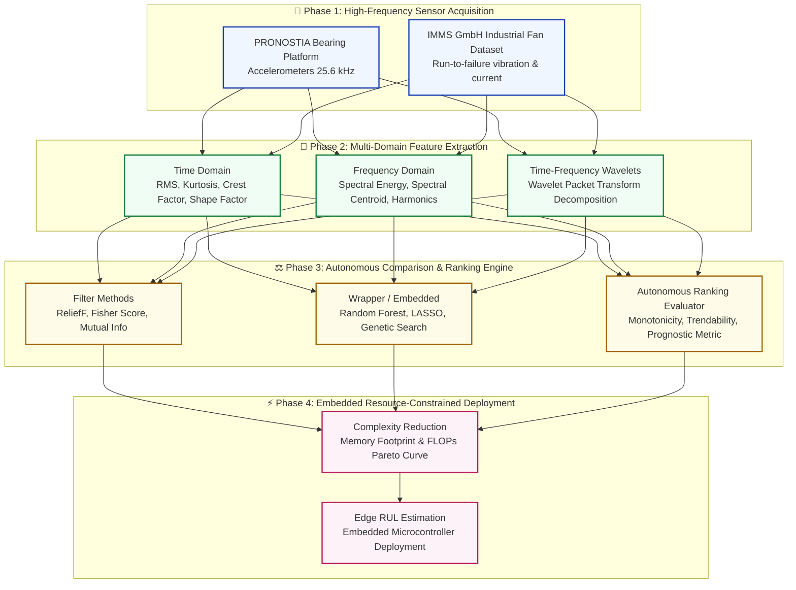

# Design and Evaluation of an Autonomous Comparison Method for Feature Ranking for Machine Prognostics

<div align="center">

[](thesis.pdf)
[](https://www.tu-ilmenau.de/)
[]()
[](LICENSE)

**Department of Electrical Engineering and Information Technology • Technische Universität Ilmenau**  
*Author: Sayan Bhattacharya | Advisors: Prof. Dr. rer. nat. Jochen Seitz, Prof. Dr.-Ing. Patrick Mäder, M.Sc. Umut Onus, M.Sc. Dominik Walther*

</div>

---

## 📌 Executive Summary & Motivation

Predictive Maintenance (PdM) relies on sensor-driven Machine Prognostics to anticipate failures before they occur. With the growing demand for edge AI deployments on resource-constrained embedded platforms (microcontrollers and digital signal processors), reducing feature dimensionality while preserving Remaining Useful Life (RUL) estimation accuracy is paramount.

This thesis introduces an **Autonomous Comparison Framework for Feature Ranking (FR)** algorithms. It evaluates filter, wrapper, and embedded selection strategies across high-dimensional time, frequency, and time-frequency domains, establishing a Pareto-optimal trade-off between computational complexity and prognostics fidelity.

---

## 🏗️ System Architecture & Prognostics Pipeline



---

## 📐 Mathematical Formulation

The autonomous comparison score assesses feature subsets across three diagnostic indicators:

1. **Monotonicity ($Mon$)**: Captures the continuous degradation trajectory of machine wear:
   $$	ext{Mon}(F) = rac{1}{K(K-1)} \sum_{k=1}^K |	ext{corr}(F, t_k)|$$

2. **Trendability ($Tre$)**: Measures the correlation between degradation trajectories across diverse operating regimes:
   $$	ext{Tre}(F) = \min_{i, j} |	ext{corr}(F^{(i)}, F^{(j)})|$$

3. **Complexity Penalty ($\mathcal{C}_{comp}$)**: Quantifies memory overhead and arithmetic operations on target DSPs:
   $$\mathcal{S}_{autonomous} = w_1 \cdot 	ext{Mon}(F) + w_2 \cdot 	ext{Tre}(F) - w_3 \cdot rac{\mathcal{C}_{comp}}{\mathcal{C}_{budget}}$$

---

## 📊 Experimental Evaluation & Benchmark Datasets

| Dataset | Operating Conditions | Sensor Inputs | Target Output |
| :--- | :--- | :--- | :--- |
| **PRONOSTIA (FEMTO-ST)** | 1800 rpm (4 kN), 1650 rpm (4.2 kN), 1500 rpm (5 kN) | Radial vibration accelerometers ($X, Y$) | Bearing Remaining Useful Life (RUL) |
| **IMMS GmbH Fan Testbed** | Variable thermal & mechanical aerodynamic loads | Multi-axis vibration, Current sensors | Fault classification & Early degradation detection |

---

## 📑 Repository Structure

```
├── thesis.pdf           # Full Master's thesis document (TU Ilmenau)
├── LICENSE              # MIT License
└── README.md            # Architectural documentation & project overview
```

---

## 🚀 Citation & Contact

If you find this research useful in your work on predictive maintenance, edge prognostics, or feature ranking, please consider citing:

```bibtex
@mastersthesis{bhattacharya2024autonomous,
  author       = {Sayan Bhattacharya},
  title        = {Design and Evaluation of an Autonomous Comparison Method for Feature Ranking for Machine Prognostics},
  school       = {Technische Universit{"a}t Ilmenau},
  year         = {2024},
  address      = {Ilmenau, Germany},
  department   = {Department of Electrical Engineering and Information Technology}
}
```

- **Author**: Sayan Bhattacharya
- **Email**: [sayanpm17@gmail.com](mailto:sayanpm17@gmail.com)
- **LinkedIn**: [linkedin.com/in/snbhattacharya5](https://www.linkedin.com/in/snbhattacharya5/)
